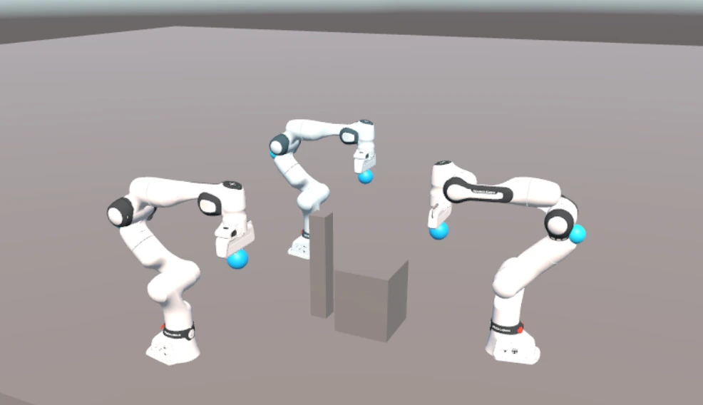

# Several robot arms

ERUPT works with any number of arms in one scene, of the same model or of different ones. Each
arm is an independent robot on the ROS side, in its own namespace, with its own MoveIt. In the
headset they share one scene: an obstacle you place is known to every arm's planner.

<figure class="guide-shot">
  <div class="namespace-map">
    
    <span aria-hidden="true" style="--arm-x: 25%; --arm-y: 35%">/right</span>
    <span aria-hidden="true" style="--arm-x: 47%; --arm-y: 20%">/left</span>
    <span aria-hidden="true" style="--arm-x: 73%; --arm-y: 35%">/third</span>
  </div>
  <figcaption>Each label shows the arm’s ROS namespace in <code>MultiArmFR3</code>. Selecting an arm switches the controls to its planner.</figcaption>
</figure>

## 1. Start one ROS stack per arm

Give every arm a namespace and say which robot it is:

```bash
ARMS="left=fr3 right=ur5e third=xarm7" \
  docker compose -f docker/compose.yaml --profile arms up arms
```

For the three Franka arms in the bundled `MultiArmFR3` scene, use
`ARMS="left=fr3 right=fr3 third=fr3"` in the same command.

Without Docker, the same list goes to the launch file:

```bash
ros2 launch erupt_bringup arms.launch.py arms:="left=fr3 right=ur5e third=xarm7"
```

There is one connection to Unity for all arms, on port 10000 as before. You do not tell the
ROS side where the arms stand.

## 2. Put the arms into the scene

1. Drag a robot prefab into the scene for every arm (see [Robots](robots.md)) and place it
   where the arm stands.
2. Select each robot and set, on its **Robot Instance** component:

   | Field | Value |
   | --- | --- |
   | **Id** | A name of your choice, shown in the headset, for example `left` |
   | **Ros Namespace** | The namespace you gave that arm in step 1, for example `left` |

That is all. The plugins find every robot in the scene on their own.

`Assets/Scenes/MultiArmFR3` is a finished example with three arms.

In the editor, open the scene and press Play. A headset build starts in the first scene of
the scene list: open **File > Build Profiles**, drag your scene (or `MultiArmFR3`) to the top
of the list, and build.

## How it behaves in the headset

- **You act on the arm you touch.** Selecting an arm's end effector, a joint or one of its plans
  makes that arm the active one. Its name appears in the menu header and on the tabs.
- **Two hands, two arms.** You can drag two arms at the same time, one with each hand.
- **Obstacles are shared.** Every obstacle goes to every arm's planning scene, each time
  expressed relative to that arm.
- **Plans, tasks and demonstrations belong to one arm.** Each arm has its own start, goal,
  plans, pick-and-place tasks and recordings.

## What to know

- **The arms do not avoid each other.** Each arm plans as if it were alone with the obstacles.
  Keep their workspaces apart, or execute one at a time when they overlap.
- **An arm can be moved.** Every robot carries its own planning frame, so moving a robot in
  the scene needs no change on the ROS side.
- **Namespaces must match exactly.** If an arm stays in its start pose and does not follow
  its ROS robot, compare the **Ros Namespace** field with the name in the `ARMS` list.

## When the ROS side needs one common frame

If other ROS software needs all arms in one frame, the arms can share a planning frame instead.
Start each arm with its base pose (`left=fr3@x,y,z,yaw`, in metres and radians), and in Unity
assign the same transform to the **Planning Frame** field of each of those robots, with the
robots placed at the same poses relative to it. Only robots whose description leaves the base
free take a pose this way (`fr3`, `iiwa14`).
