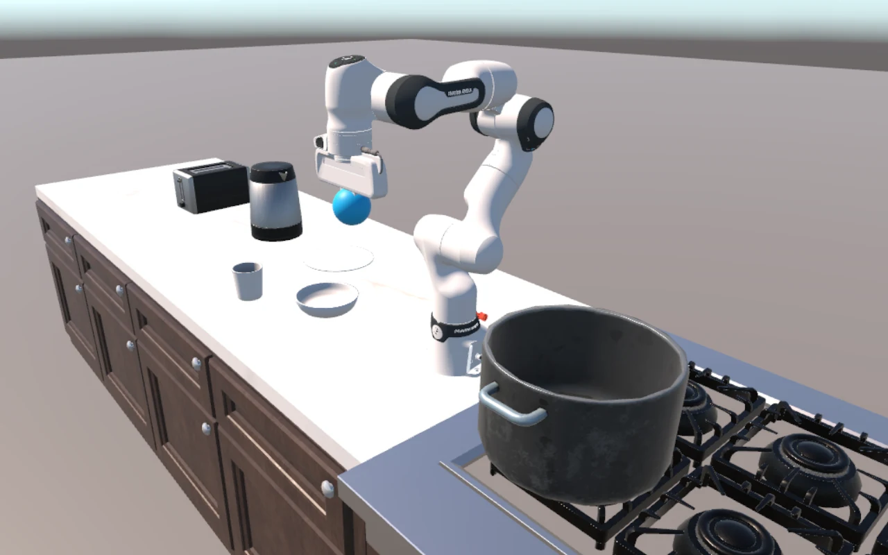
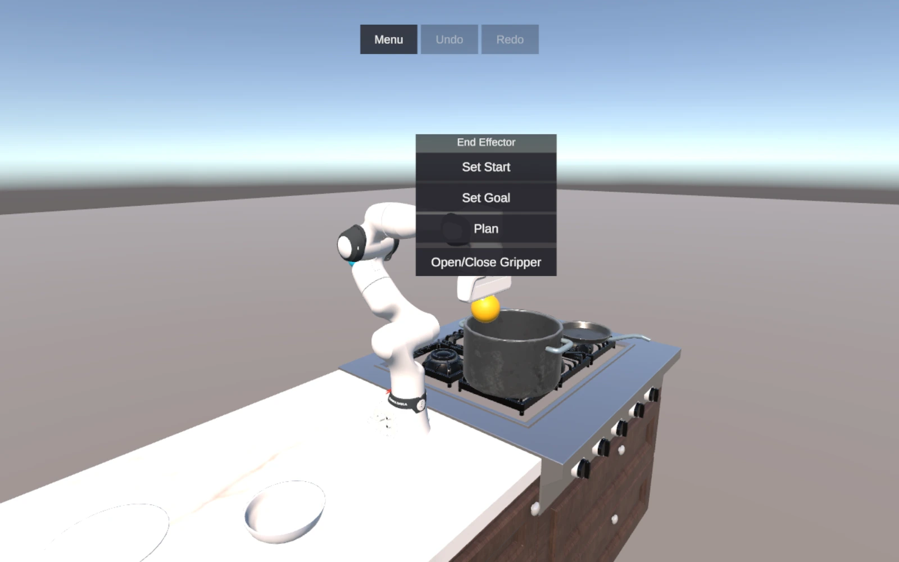
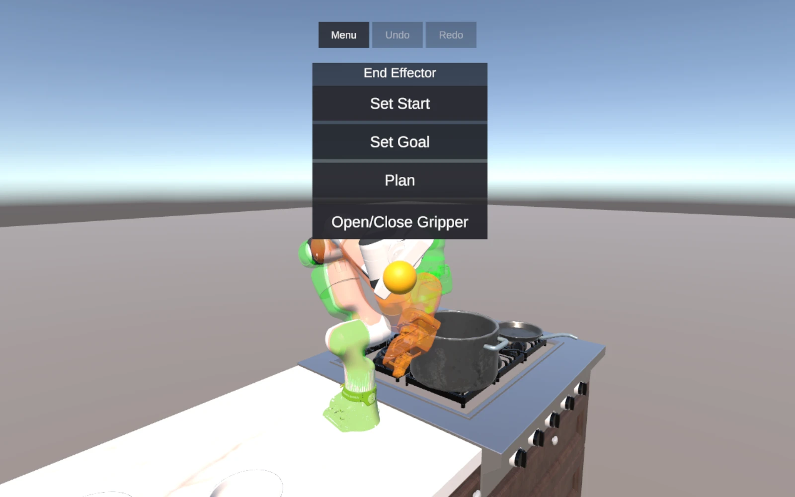
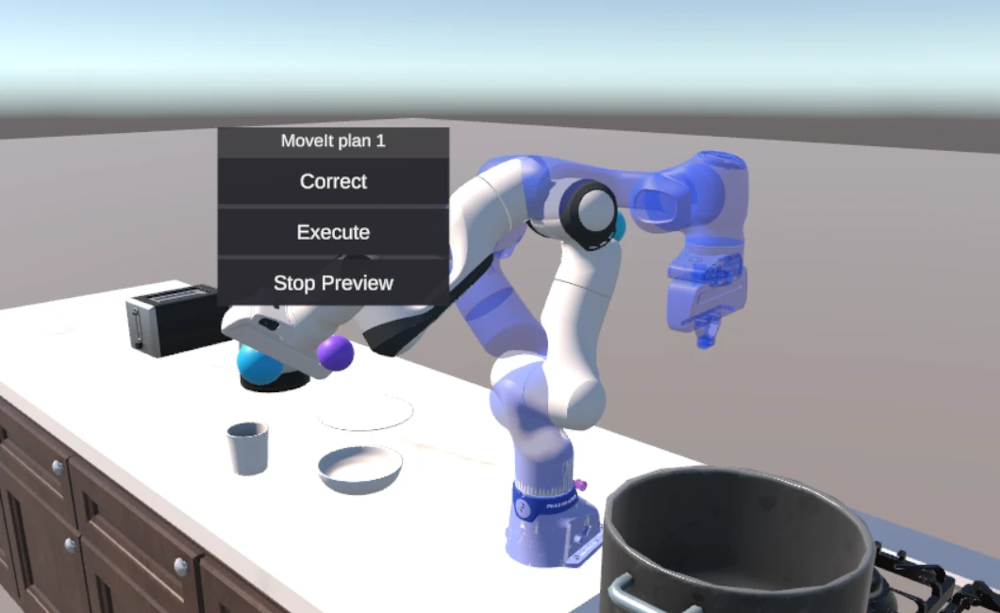

# Quick start

This gets you from nothing to planning and executing a motion on a simulated Franka Research 3,
first in the Unity editor and then in the headset. It takes about half an hour, most of it
waiting for downloads and the first build.

<figure class="guide-shot guide-overview">
  <a href="../images/kitchen-fr3.webp"></a>
  <figcaption>In the kitchen scene, you’ll move the blue handle to give the Franka arm its first goal.</figcaption>
</figure>

## Before you start

- Unity 6 (the exact version is in `ProjectSettings/ProjectVersion.txt`), with Android Build
  Support if you want to run in the headset
- `git` on your PATH
- Docker (Docker Desktop, or Colima on a Mac) for the simulated robot
- For the headset part: a Meta Quest 3 in developer mode, on the same network as your computer

## 1. Start the robot

The robot, MoveIt and the bridge to Unity run in a container.

```bash
git clone https://github.com/parasollab/erupt_ws.git
cd erupt_ws
docker compose -f docker/compose.yaml up
```

The first run builds the image, which takes a while. When the log settles, a simulated FR3 is
waiting on port 10000. Leave it running.

## 2. Open the project

```bash
git clone https://github.com/parasollab/erupt.git
```

Open the folder in Unity. The first open downloads the packages the project uses, some of
them from GitHub, and imports the project. That takes several minutes and needs no account
beyond the one Unity itself asks for.

## 3. Run in the editor

1. Open `Assets/Scenes/KitchenFR3`.
2. Press Play. The Game view shows the robot on the kitchen counter, with **Menu**, **Undo**
   and **Redo** at the top and the keys in the lower left corner. The Unity console should
   show no repeating `Connection to ... failed` message; if it does, see
   [Troubleshooting](troubleshooting.md).

### Plan your first motion

<fieldset class="motion-steps" aria-labelledby="plan-your-first-motion">
  <div class="motion-frames">
    <input id="motion-select" aria-controls="select-frame" type="radio" name="motion-step" checked>
    <label for="motion-select">Select the handle</label>
    <input id="motion-goal" aria-controls="goal-frame" type="radio" name="motion-step">
    <label for="motion-goal">Set a goal</label>
    <input id="motion-plan" aria-controls="plan-frame" type="radio" name="motion-step">
    <label for="motion-plan">Preview the plan</label>
    <figure id="select-frame">
      <a href="../images/kitchen-fr3-selection.webp"></a>
      <figcaption>Left-click the blue sphere at the end effector. When the handle turns yellow, click <strong>Set Start</strong> in the menu to save the arm’s current pose.</figcaption>
    </figure>
    <figure id="goal-frame">
      <a href="../images/kitchen-fr3-goal.webp"></a>
      <figcaption>Hold the right mouse button on the sphere and drag it to the pose you want. Release the mouse button and click <strong>Set Goal</strong>. Green marks the start pose and orange marks the goal. The orange copy appears where the arm is, so the arm in this picture has been dragged up and out of it to show both.</figcaption>
    </figure>
    <figure id="plan-frame">
      <a href="../images/kitchen-fr3-plan.webp"></a>
      <figcaption>Click <strong>Plan</strong>. The translucent blue arm plays the motion on a loop while the solid arm stays still. Choose <strong>Stop Preview</strong> to end playback. If you select something else, point at the purple sphere and select it to reopen this plan’s menu.</figcaption>
    </figure>
  </div>
</fieldset>

<figure class="guide-shot">
  <video controls loop muted playsinline preload="metadata" width="1280" height="800" style="display: block; width: 100%; max-width: 100%; height: auto; aspect-ratio: 8 / 5" poster="../images/kitchen-fr3-plan.webp" aria-label="The blue copy of the arm moving from the start pose to the goal pose, over and over.">
    <source src="../images/kitchen-fr3-plan.mp4" type="video/mp4">
  </video>
  <figcaption>The preview as it plays. The motion takes about a second and a half and repeats until you stop it.</figcaption>
</figure>

When you’re ready, click **Execute** in the plan menu. The preview ends, the simulated
robot moves, and the arm in Unity follows it.

To look around, use `W` `A` `S` `D` to move, the arrow keys to turn, and `F` to get back to
a view of the robot. `Tab` opens the panel with the settings and the tools for adding
obstacles. [Using the app](using-the-app.md#in-the-unity-editor-without-a-headset) lists
every key.

Without changing anything, Unity connects to `127.0.0.1:10000`, which is right when Docker
runs on the same computer.

## 4. Run in the headset

1. Find your computer's address on the local network.
2. In Unity, open **Robotics > ROS Settings** and enter that address as the ROS IP address,
   port 10000. The headset cannot use `127.0.0.1`.
3. Open **File > Build Profiles**, switch to Android, connect the headset, and choose
   **Build And Run**. The app starts in the first scene of the profile's scene list, which
   is `KitchenFR3`.
4. In the headset, the bar on your left wrist has **Menu**, **Undo** and **Redo**. Point at
   the end effector and pull the trigger to select it, hold the grip to drag its handle, and
   use the menu next to it as you did with the mouse.

[Using the app](using-the-app.md) explains all the controls.

## Where to go next

- A different robot: [Robots](robots.md)
- Two or more arms: [Several robot arms](multi-arm.md)
- Pick-and-place and demonstrations: [Using the app](using-the-app.md),
  [Collecting demonstrations](demonstrations.md)
- Your own Unity project instead of this one: [Add ERUPT to your own project](install-package.md)
- A real robot: [The ROS 2 side](ros-setup.md)
