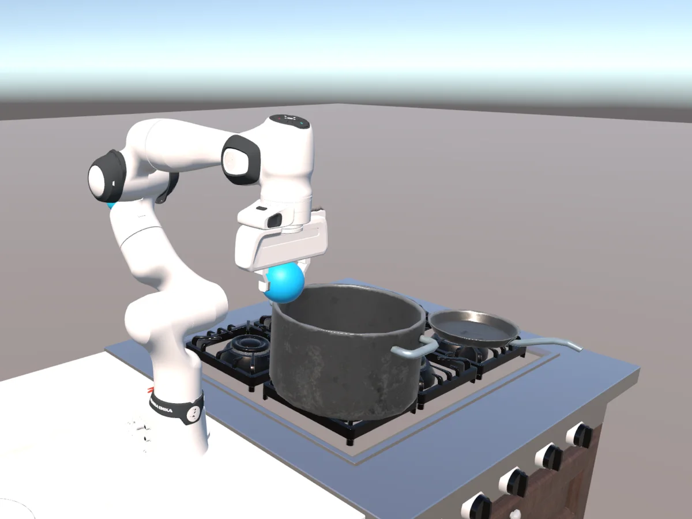
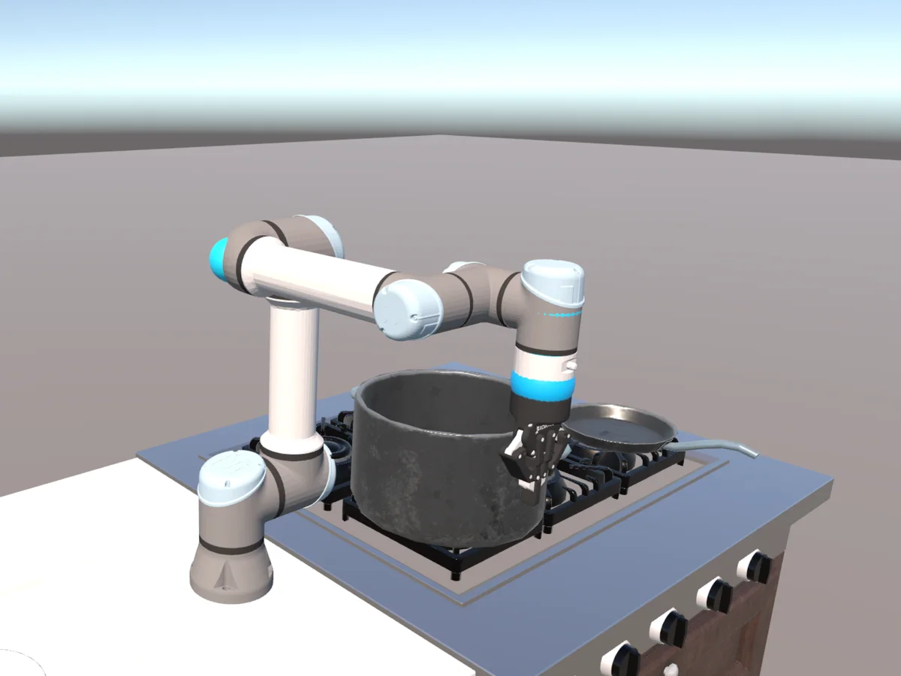
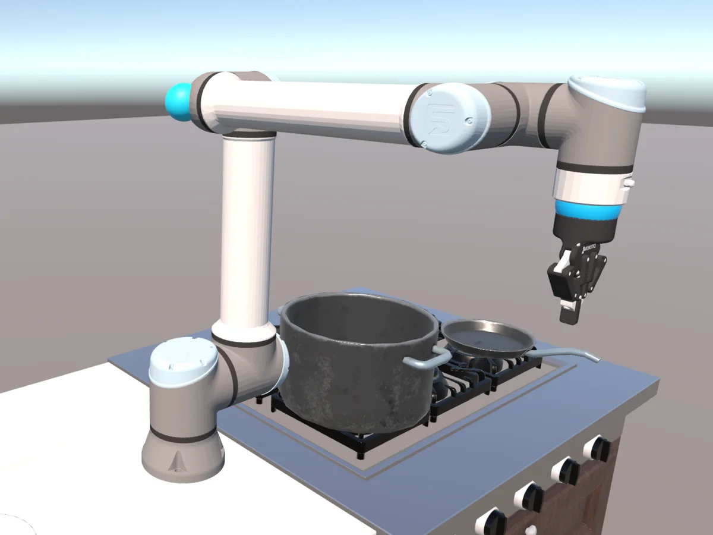
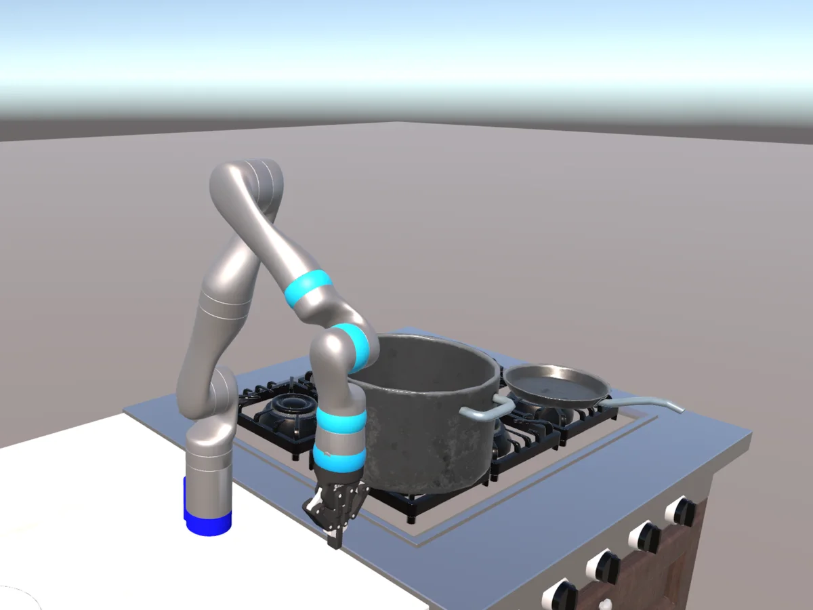
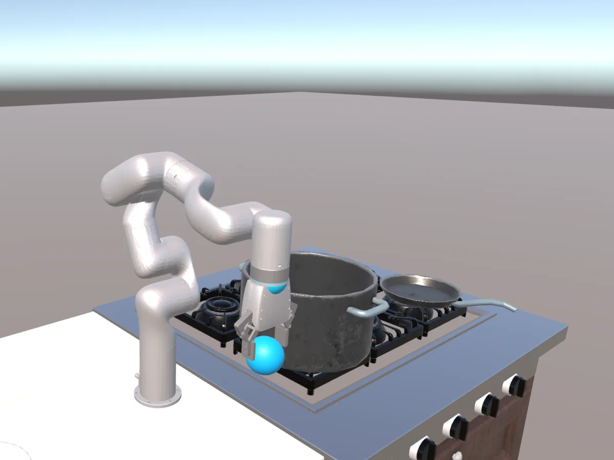
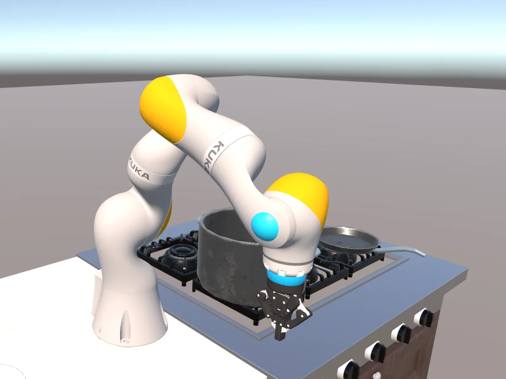

# Robots

ERUPT ships six arms. Each is a prefab you drag into a scene, with a matching simulated robot
on the ROS side.

| Robot | Gripper | Prefab | Start the ROS side with |
| --- | --- | --- | --- |
| Franka Research 3 | Franka hand | `Packages/com.erupt.robot.franka/Robots/FR3` | `ROBOT=fr3` |
| Universal Robots UR5e | Robotiq 2F-85 | `Packages/com.erupt.robot.universal-robots/Robots/UR5e` | `ROBOT=ur5e` |
| Universal Robots UR10e | Robotiq 2F-85 | `Packages/com.erupt.robot.universal-robots/Robots/UR10e` | `ROBOT=ur10e` |
| Kinova Gen3 (7 joints) | Robotiq 2F-85 | `Packages/com.erupt.robot.kinova/Robots/Gen3` | `ROBOT=kinova_gen3` |
| UFactory xArm7 | xArm gripper | `Packages/com.erupt.robot.ufactory/Robots/xArm7` | `ROBOT=xarm7` |
| KUKA LBR iiwa 14 | Robotiq 2F-85 | `Packages/com.erupt.robot.kuka/Robots/iiwa14` | `ROBOT=iiwa14` |

<div class="robot-gallery">
  <figure>
    <a href="../images/robot-fr3.webp"></a>
    <figcaption>Franka Research 3<span>Franka hand</span></figcaption>
  </figure>
  <figure>
    <a href="../images/robot-ur5e.webp"></a>
    <figcaption>Universal Robots UR5e<span>Robotiq 2F-85</span></figcaption>
  </figure>
  <figure>
    <a href="../images/robot-ur10e.webp"></a>
    <figcaption>Universal Robots UR10e<span>Robotiq 2F-85</span></figcaption>
  </figure>
  <figure>
    <a href="../images/robot-kinova-gen3.webp"></a>
    <figcaption>Kinova Gen3<span>Robotiq 2F-85</span></figcaption>
  </figure>
  <figure>
    <a href="../images/robot-xarm7.webp"></a>
    <figcaption>UFactory xArm7<span>xArm gripper</span></figcaption>
  </figure>
  <figure>
    <a href="../images/robot-iiwa14.webp"></a>
    <figcaption>KUKA LBR iiwa 14<span>Robotiq 2F-85</span></figcaption>
  </figure>
</div>

Each picture is the same kitchen scene with the robot swapped, from the same place, in the
pose the simulated robot starts in.

The Unity robot and the ROS robot are made from the same description, so joint names, limits,
planning groups and named poses agree on both sides.

## Use a different robot

1. Open a scene that has the ERUPT root, an XR rig and the plugins. `Assets/Scenes/KitchenFR3`
   has them, and so does the Starter Scene sample.
2. Delete the robot that is in the scene, if there is one.
3. Drag the prefab of the robot you want into the scene and put it where it should stand.
   Nothing has to be wired.
4. Start the ROS side for the same robot, in `erupt_ws`:

   ```bash
   ROBOT=ur5e docker compose -f docker/compose.yaml up
   ```

5. Press Play. The robot takes the pose of the simulated one.

You do not tell the ROS side where the robot stands. Every robot prefab carries its own
planning frame, and ERUPT sends obstacles to the robot relative to it.

For more than one robot in a scene, see [Several robot arms](multi-arm.md).

## Joint limits

ERUPT never moves a joint past its limits, whether you drag the arm, jog a joint, preview a
plan or mirror the ROS robot. When a joint reaches a limit while you drag, the arm stops, the
link is tinted and a message names the joint. A plan that would leave the limits can be
previewed but not executed.

The limits come from the robot description. To tighten them for your cell, select the robot's
profile (the `.asset` next to the prefab) and set an override on the joint; overrides survive
a later update of the robot.

## Pick and place with each gripper

The pick-and-place server takes an object from above, with the fingertips around the origin
of the object. When the hand would touch the table or the top of the object there, the server
moves the grasp towards the fingertips by itself. An object has to fit between the open
fingers: about 8 cm for the Robotiq 2F-85 and the xArm gripper, 7 cm for the Franka hand.

## A robot that is not in the list

See [Adding a robot](add-a-robot.md). You need its URDF and meshes; a MoveIt configuration
makes it quicker.
