# Using the app

ERUPT shows your robot and its surroundings in the headset. You build the surroundings, tell
the robot where to go, look at the plan before anything moves, and then run it.

## Where the controls are

Controls live in three places, called tiers. Nothing else in the app is a menu.

- **Tier 1, the wrist bar.** Floats just above the back of your left hand like a watch
  face, with a controller or with bare hands. It has **Menu**, which opens and closes the
  panel, **Undo** and **Redo**. Press it with your right hand: point and pull the trigger,
  or poke it.
- **Tier 2, the menu on the selected thing.** Select something and its actions appear above
  it:
  - an obstacle: **Resize**, **Delete**, **Snap to Surface**, **Duplicate**
  - the end effector: **Set Goal**, **Open/Close Gripper**, **Set Start**, **Plan**
  - a plan: **Execute**, **Preview** (or **Stop Preview** while it plays)
- **Tier 3, the panel.** Open it with **Menu** on the wrist bar, with the controller's Menu
  button, or with the hand menu gesture. It shows one tab at a time:
  - **Scene**: add a cube, sphere or cylinder
  - **MoveIt**: planner, attempts and allowed time, and whether the robot mirrors the ROS
    robot's joints
  - **MTC**: the pick-and-place recorder, the stage tree and the best solutions
  - **Demonstrations**: record, replay and publish
  - **Settings**: the collision haptics (see below)

  A tab is there only when its module is: without the MTC package there is no MTC tab, and
  the same goes for the actions a module adds to the menus.

<figure class="guide-shot">
  <a href="../images/kitchen-fr3-selection.webp">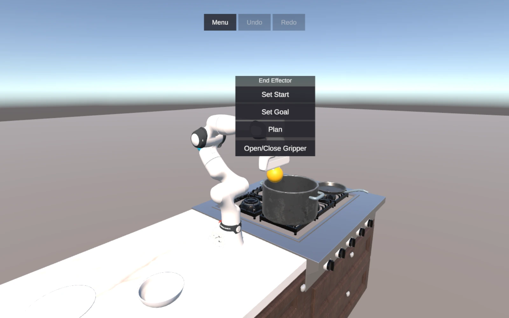</a>
  <figcaption>Tier 1 is the bar with <strong>Menu</strong>, <strong>Undo</strong> and <strong>Redo</strong>. Tier 2 is the menu above the selection, here the end effector. The pictures on this page are from the editor without a headset, where the bar sits at the top of the view instead of on your wrist.</figcaption>
</figure>

Tier 3, the panel, tab by tab:

<fieldset class="motion-steps" aria-label="The tabs of the panel">
  

    <input id="panel-scene" type="radio" name="panel-tab" checked>
    <label for="panel-scene">Scene</label>
    <input id="panel-moveit" type="radio" name="panel-tab">
    <label for="panel-moveit">MoveIt</label>
    <input id="panel-mtc" type="radio" name="panel-tab">
    <label for="panel-mtc">MTC</label>
    <input id="panel-demonstrations" type="radio" name="panel-tab">
    <label for="panel-demonstrations">Demonstrations</label>
    <input id="panel-settings" type="radio" name="panel-tab">
    <label for="panel-settings">Settings</label>
    <figure>
      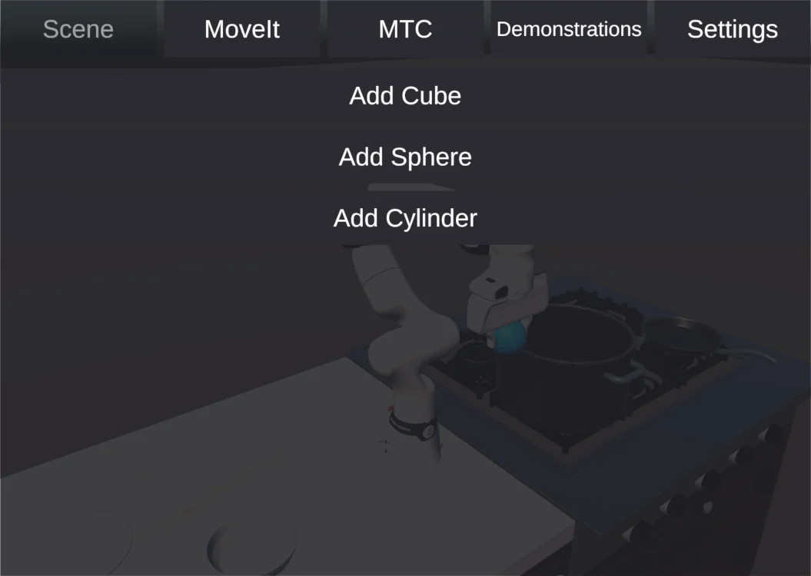
      <figcaption><strong>Scene.</strong> Each button puts a shape in front of you, selected and ready to move.</figcaption>
    </figure>
    <figure>
      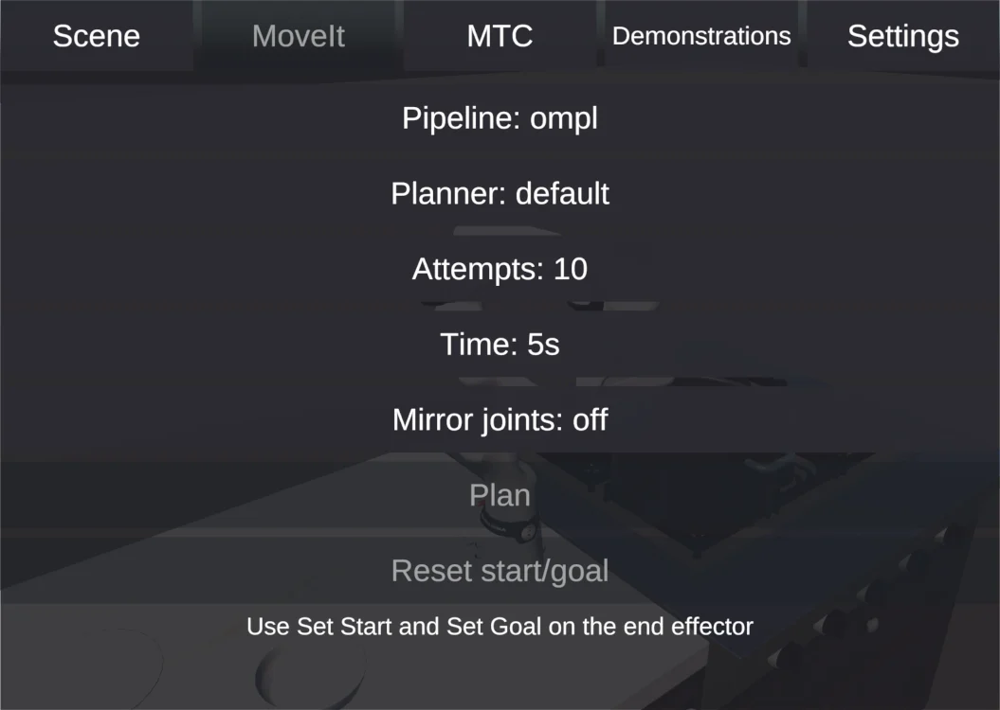
      <figcaption><strong>MoveIt.</strong> Press a setting to step through its values. <strong>Plan</strong> and <strong>Reset start/goal</strong> are greyed out until a start and a goal are set.</figcaption>
    </figure>
    <figure>
      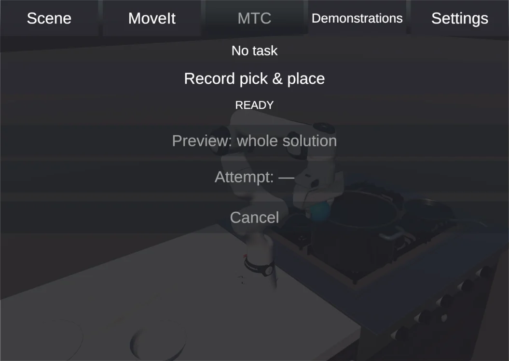
      <figcaption><strong>MTC.</strong> Before a task is recorded, only <strong>Record pick &amp; place</strong> can be pressed.</figcaption>
    </figure>
    <figure>
      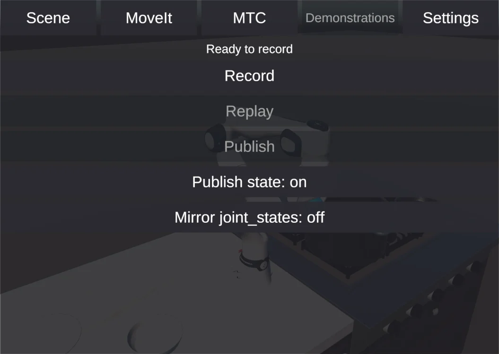
      <figcaption><strong>Demonstrations.</strong> <strong>Replay</strong> and <strong>Publish</strong> are greyed out until something is recorded.</figcaption>
    </figure>
    <figure>
      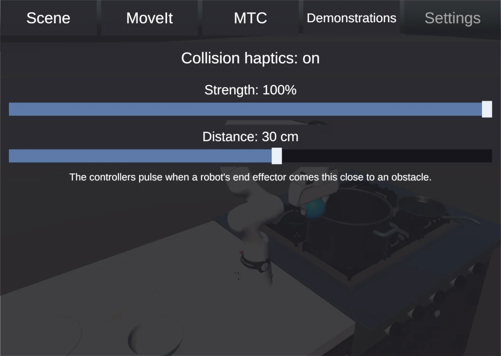
      <figcaption><strong>Settings.</strong> The collision haptics, described <a href="#collision-haptics">below</a>.</figcaption>
    </figure>
  

</fieldset>

## The basic flow

1. Open the panel's Scene tab and place an obstacle. Grab it to move it; use its menu to
   resize it. Every obstacle is sent to MoveIt as a collision object.
2. Select the robot's end effector.
3. Choose **Set Start**. The motion will start from the pose the robot is in now, which stays
   visible as a translucent copy of the robot.
4. Drag the end-effector handle to where the robot should go, then choose **Set Goal**. A
   second translucent copy marks the goal.
5. Choose **Plan**. When the plan arrives, a blue translucent copy of the robot plays it,
   over and over, and the plan becomes the selection, so its menu is in front of you. The
   robot itself does not move during a preview. The plan stays in the scene as a small purple
   sphere halfway between the start and the goal; select that sphere to get the plan's menu
   back later.
6. Choose **Stop Preview** when you have seen enough (and **Preview** to watch it again), or
   **Execute** to run the plan. Executing ends the preview, and the robot itself then follows
   the ROS robot through the motion.

After the robot has moved, choose **Set Start** again before the next plan.

  <figure class="guide-shot">
    <a href="../images/obstacle-menu.webp">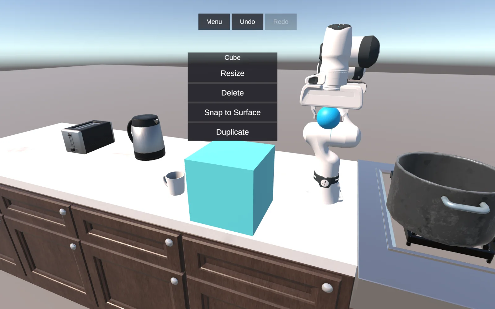</a>
    <figcaption>Step 1: a new cube is selected, so its menu is there straight away.</figcaption>
  </figure>
  <figure class="guide-shot">
    <a href="../images/obstacle-resize.webp">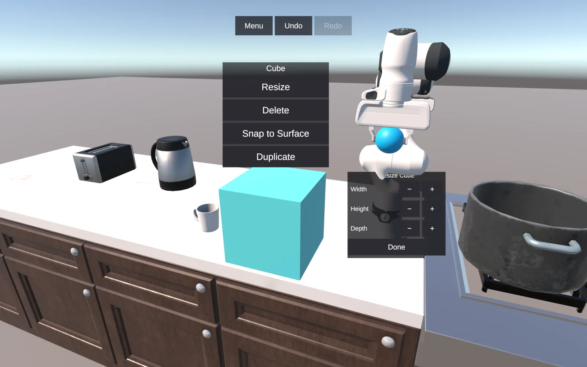</a>
    <figcaption><strong>Resize</strong> opens a minus and a plus for each dimension.</figcaption>
  </figure>

<figure class="guide-shot">
  <a href="../images/home-plan-preview.webp">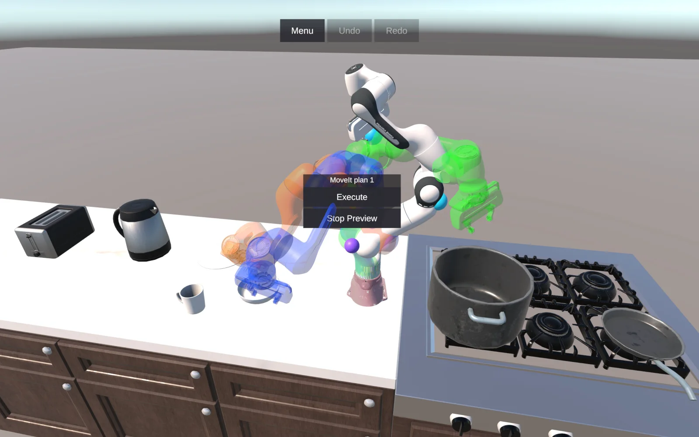</a>
  <figcaption>Step 5: the preview. Green is the start, orange the goal, blue the motion, and the purple sphere is the plan. The goal copy appears where the robot is when you choose <strong>Set Goal</strong>; here the robot has been dragged up and out of it afterwards. The <a href="quick-start.md">quick start</a> shows the steps one at a time.</figcaption>
</figure>

When the app connects, each robot takes the pose its ROS robot reports, once. After that the
robot in the headset is yours to pose, and it follows the ROS robot only while a motion is
executed or while **Mirror joints** is on in the MoveIt tab. A start you had already set is
kept.

For a pick-and-place task, open the MTC tab and press **Record pick &
place**. Grab the object and let it go where it should end up. ERUPT sends the task to MoveIt
Task Constructor and lists the best three solutions it finds. Select one to see its stages,
preview the whole solution or one stage at a time, and execute it. For a stage that failed,
the tab shows the planner's reason.

  <figure class="guide-shot">
    <a href="../images/pick-place-record.webp">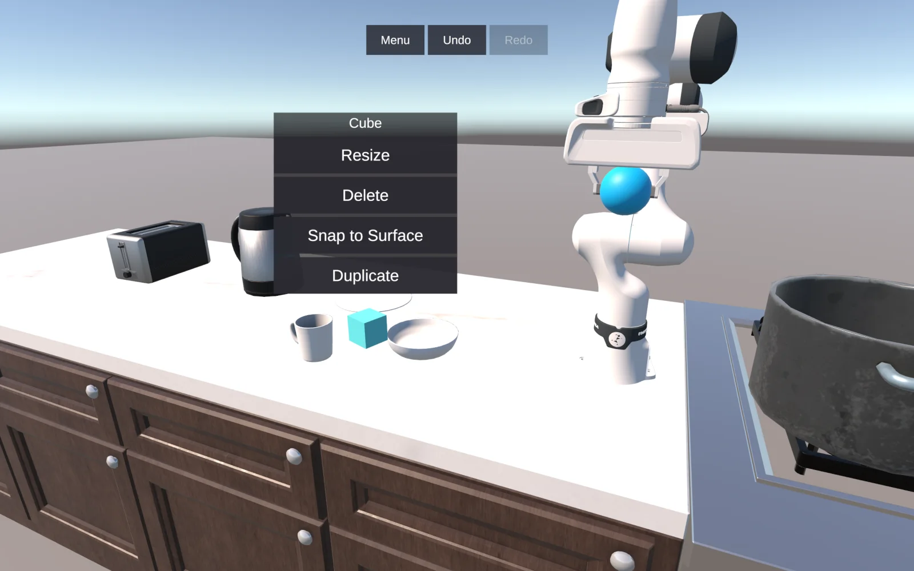</a>
    <figcaption>While recording, the object is carried to where it should end up.</figcaption>
  </figure>
  <figure class="guide-shot">
    <a href="../images/pick-place-preview.webp">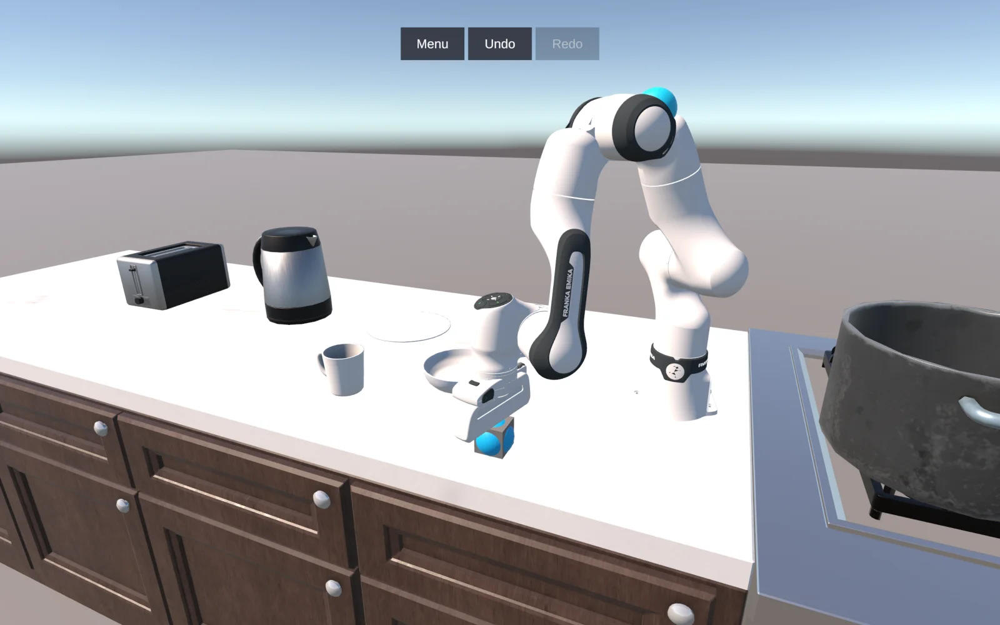</a>
    <figcaption>The preview of a solution plays on the robot itself, and the object rides in the gripper.</figcaption>
  </figure>

For a demonstration, press Record in the Demonstrations tab, move the
robot by its handle, and stop. You can replay the demonstration and publish it to ROS. See
[Collecting demonstrations](demonstrations.md).

## Controllers and hands

Put the controllers down and the app switches to tracked hands. Pick one up and it switches
back. Every feature works with either.

| Action | Controller | Hand |
| --- | --- | --- |
| Select what the ray points at | Trigger | Pinch thumb and index finger |
| Drag the end-effector handle, a joint handle or a link | Hold grip | Pinch, then hold or move |
| Jog the selected joint | Thumbstick up or down | Pinch thumb and middle finger, then raise or lower the hand |
| Grab the selected obstacle | Grip | Pinch, near or at a distance |
| Press a button on a menu or panel | Ray and trigger | Ray and pinch, or poke with the index finger |
| Open the tier 3 panel | **Menu** on the wrist bar, or the Menu button | **Menu** on the wrist bar, or turn the left palm toward your face and pinch |

Hands have no locomotion (walk instead) and no haptics.

## Collision haptics

Both controllers pulse when a robot's end effector comes close to an obstacle, more strongly
the closer it gets. The panel's **Settings** tab changes this while you use the app:

| Control | What it does |
| --- | --- |
| **Collision haptics: on / off** | Switches the pulses on or off |
| **Strength** | How strong the pulse is at contact, from 0 to 100 % |
| **Distance** | How close the end effector has to come before the pulses start, from 5 to 50 cm |

The settings are remembered the next time you start the app.

## In the Unity editor, without a headset

Press Play with no headset connected and the mouse and keyboard take over. The wrist bar sits
at the top of the Game view and the panel opens in front of the camera.

| Input | Does |
| --- | --- |
| Left click | Selects what is under the pointer and presses buttons. A click on nothing clears the selection |
| Hold the right button and drag | Moves the arm by its end-effector handle, a joint handle or a link, or moves the selected obstacle |
| Scroll wheel while dragging | Pushes the dragged point away or pulls it closer |
| Scroll wheel otherwise | Turns the selected joint |
| `Tab` | Opens and closes the panel |
| `W` `A` `S` `D` | Move the view |
| `Q` / `E` | Move the view down / up |
| Left `Shift`, held | Move three times as fast |
| Arrow keys, or hold the middle button and drag | Look around |
| `F` | Return to a view of the robots |
| `H` | Hide or show the list of keys |

Some things need the headset: turning an obstacle (the mouse only moves it), scaling with two
hands, and moving two arms at once.

The mouse and keyboard switch themselves off as soon as a headset is connected. To change a
key or switch them off altogether, select the `ERUPT` object in the scene and look at
**Desktop Controls**.

## Joint limits

The robot in the headset cannot be moved past its joint limits, whichever way you move it.

- When you drag the end effector and a joint reaches its limit, the robot stops following,
  the link at the limit is tinted, a short message names the joint, and the controller that
  caused it pulses twice.
- When a plan or a pick-and-place solution contains a joint value outside the limits, ERUPT
  tells you which joint, shows the preview clamped to the limits, and refuses to execute it.
  A planner plugin can be set to allow execution anyway (`allowExecutionOutsideLimits`).
- When you replay a demonstration that leaves the limits, ERUPT names the joint and shows the
  replay clamped.
- When the real or simulated robot reports a joint position outside the limits ERUPT knows,
  the robot model in Unity and the robot description in ROS disagree. ERUPT shows the robot
  at the limit and warns about the mismatch.

<figure class="guide-shot">
  <a href="../images/joint-limit.webp">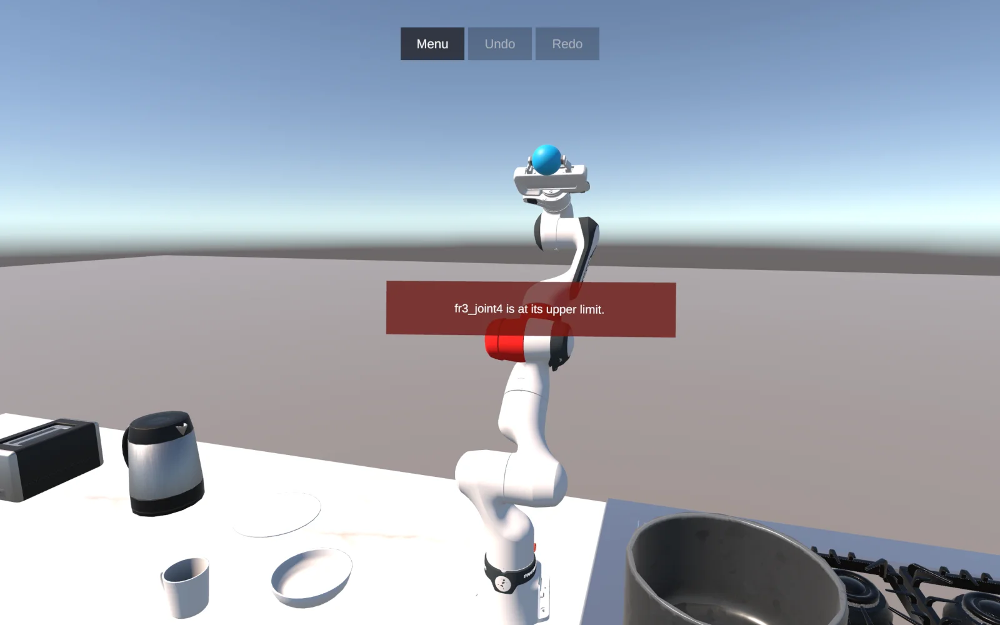</a>
  <figcaption>The elbow joint turned as far as it goes: the link it moves is tinted and the message names the joint.</figcaption>
</figure>

The limits come from the robot's profile, which is generated from its URDF. See
[Adding a robot](add-a-robot.md).

## Several robots

A scene can hold any number of robots. Each one is selected, dragged, planned for and executed
on its own, and two hands can move two robots at once.

The robot you last selected a part of is the *active* robot. While the scene has more than one
robot, the active robot is lightly tinted, the menu on a selection names its robot
("End Effector · left"), and the tier 3 tabs show the active robot's planner, tasks and
demonstrations ("MoveIt · left"). Select a part of another robot to switch.

See [Several robot arms](multi-arm.md) for how to set this up.

## When something is refused

An action that cannot be carried out is never silently dropped. A short message appears where
you were pointing and says why: the goal is out of reach, a joint is at its limit, no planner
is connected for this robot, the robot has no gripper, the execution failed on the ROS side,
and so on.

<figure class="guide-shot">
  <a href="../images/out-of-reach.webp">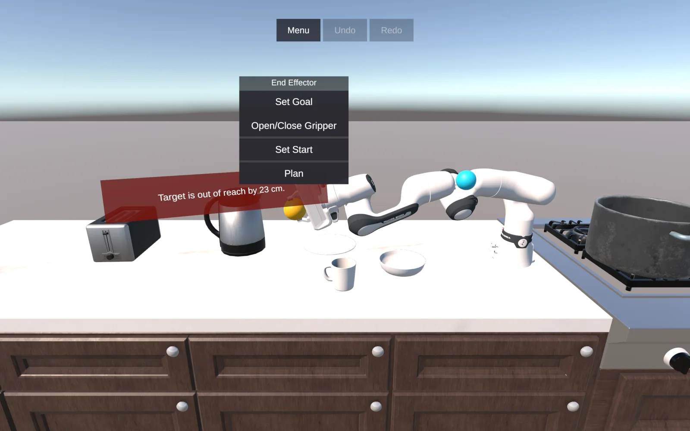</a>
  <figcaption>The handle was dragged further than the arm goes. The arm follows as far as it can and the message says by how much it falls short.</figcaption>
</figure>
