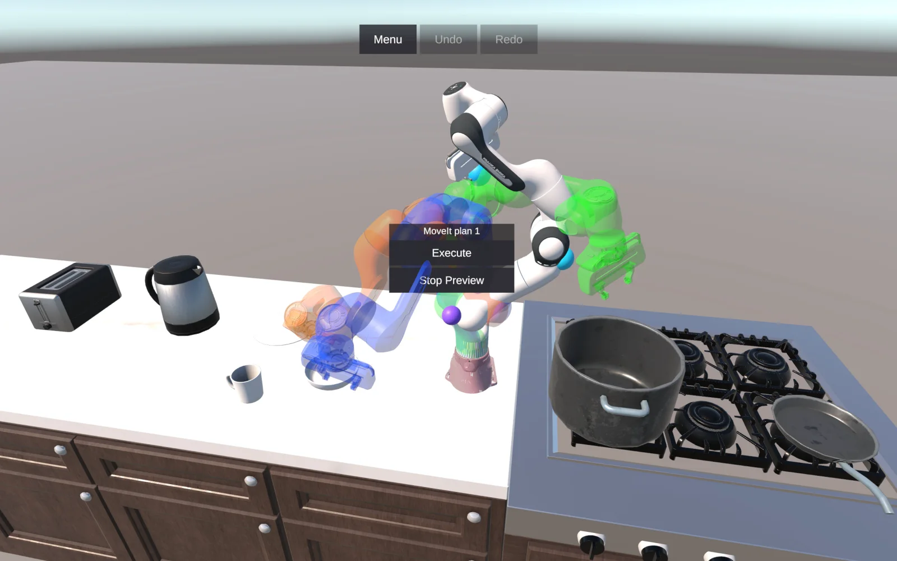

<section class="field-hero" aria-labelledby="erupt">
  

    

      
ERUPT Documentation

      <h1 id="erupt">Robot programming  in extended reality.</h1>
      
Pose a robot arm, preview its motion, and run the plan. Start with a mouse in Unity or step into the scene with a Meta Quest headset.

      

        <a class="field-button" href="guides/quick-start.md">Get started</a>
        <a class="field-source" href="https://github.com/parasollab/erupt">View on GitHub</a>
      

    

    <figure class="field-view">
      
      <figcaption>KitchenFR3StartGoalMotion previewPlan handle</figcaption>
    </figure>
  

</section>

  <section aria-labelledby="start-here">
    <h2 id="start-here">Explore the toolkit</h2>
    

      <section>
        <i class="bi bi-bounding-box-circles" aria-hidden="true"></i>
        <h3>Operate the robot</h3>
        
Set a goal, place obstacles, and inspect a plan before the arm moves.

        <ul>
          <li><a href="guides/using-the-app.md">Controls and motion planning</a></li>
          <li><a href="guides/demonstrations.md">Record a demonstration</a></li>
          <li><a href="guides/ar.md">Place the robot in AR</a></li>
        </ul>
      </section>
      <section>
        <i class="bi bi-layers" aria-hidden="true"></i>
        <h3>Set up a workspace</h3>
        
Connect Unity to MoveIt 2 and choose the arms for your scene.

        <ul>
          <li><a href="guides/ros-setup.md">Connect ROS 2</a></li>
          <li><a href="guides/robots.md">Choose a robot</a></li>
          <li><a href="guides/multi-arm.md">Run several arms</a></li>
        </ul>
      </section>
      <section>
        <i class="bi bi-braces" aria-hidden="true"></i>
        <h3>Build with ERUPT</h3>
        
Bring the toolkit into a Unity project or add your own planning method.

        <ul>
          <li><a href="guides/install-package.md">Install the packages</a></li>
          <li><a href="guides/add-a-robot.md">Add a robot from URDF</a></li>
          <li><a href="guides/write-a-plugin.md">Write a plugin</a></li>
        </ul>
      </section>
    

  </section>
  

    <section aria-labelledby="how-it-is-put-together">
      <h2 id="how-it-is-put-together">Inside ERUPT</h2>
      
The Extended Reality Universal Programming Toolkit is a set of Unity packages. Core handles input, inverse kinematics, joint limits, and ROS transport. Plugins add motion planning, pick-and-place tasks, demonstrations, and AR placement.

      
<a href="../Packages/com.erupt.core/Documentation~/architecture.md">Architecture reference</a> / <a href="api/index.md">API reference</a>

    </section>
    <section aria-labelledby="requirements">
      <h2 id="requirements">What you’ll need</h2>
      
Use Unity 6 and Docker to try the simulated robot. For a headset session, use a Meta Quest 3. An existing ROS 2 Jazzy and MoveIt 2 setup can also supply the robot.

      
<a href="guides/troubleshooting.md">Troubleshoot your setup</a>

    </section>
  

